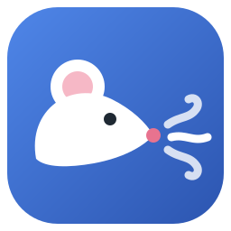
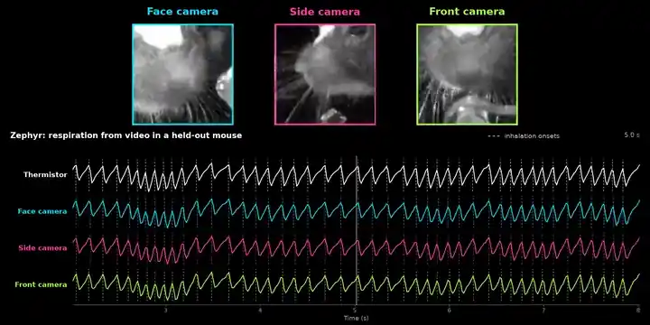
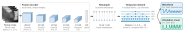
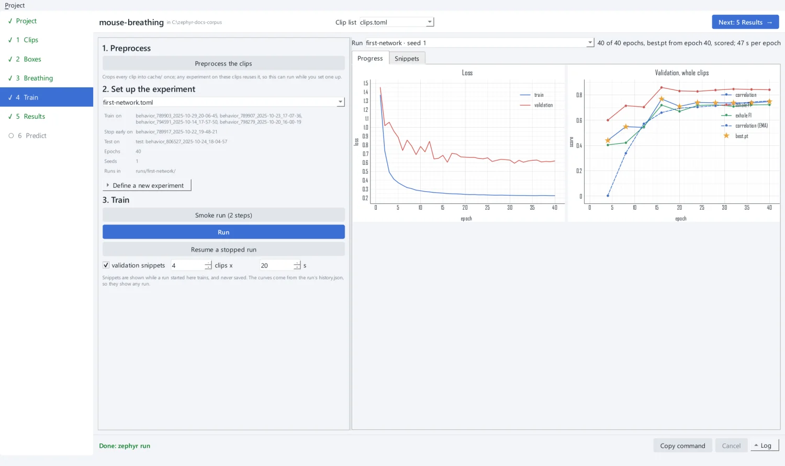

<div align="center">



# Zephyr

### Breathing from video.

**A network that reads a mouse's breathing, and each inhale, from a camera on its snout.**

[](https://github.com/AllenNeuralDynamics/zephyr/actions/workflows/zephyr-cicd.yml)
[](https://allenneuraldynamics.github.io/zephyr/)
[](https://github.com/AllenNeuralDynamics/zephyr/releases)
[](https://allenneuraldynamics.github.io/zephyr/installation/)
[](LICENSE)

**[Documentation](https://allenneuraldynamics.github.io/zephyr/) · [Tutorial](https://allenneuraldynamics.github.io/zephyr/tutorial/) · [Try it online](https://allenneuraldynamics.github.io/zephyr/app/)**

[Quick start](#quick-start) · [What it does](#what-it-does) · [How it works](#how-it-works) · [The app](#the-app) · [Your own data](#your-own-data) · [The paper](#the-paper) · [Documentation](#documentation)

<br />



<sub>A mouse Zephyr never trained on: the crop each camera's network reads, the thermistor
(white) and the breathing each network predicts from video alone, with the inhales it
marks (dashed).</sub>

</div>

---

Zephyr learns breathing from recordings that have a breathing sensor (a nasal thermistor,
for example) beside the camera, then predicts it on videos that have none. It needs no
markers and no pose tracking: only a crop box around the snout. A desktop app walks a
project from raw videos to a trained, scored network and its predictions on new animals,
and every step is also a `zephyr` command you can script on a cluster.

## Quick start

Zephyr needs Python 3.11+, [uv](https://docs.astral.sh/uv/) and `ffmpeg` on your `PATH`.

```bash
git clone https://github.com/AllenNeuralDynamics/zephyr
cd zephyr
uv sync --locked --all-packages --extra gpu --extra ui    # or --extra cpu
uv run zephyr gui
```

The app opens on a project folder and guides you through each step. The
[tutorial](https://allenneuraldynamics.github.io/zephyr/tutorial/) takes a few sessions of
our dataset (public, no credentials needed) from videos to predictions.

No install? **[Try it online](https://allenneuraldynamics.github.io/zephyr/app/)**: choose
an MP4, place the crop box on the snout, and get the predicted breathing. The video never
leaves your computer; it is decoded and predicted on your own GPU in Chrome or Edge.

## What it does

- **One input: gray frames.** Each frame is cropped to a box around the snout and
  converted to gray. Zephyr needs no markers and no pose tracking.
- **Two outputs.** A continuous breathing trace, and an *onset head* that marks each
  inhale with a probability.
- **The view you have.** A network learns the camera view it is trained on: face, side
  or front.
- **Quality control without a sensor** (experimental). Each prediction gets label-free
  scores, placed among the network's own validation windows.

## How it works

<div align="center">

</div>

Frames are picked from the camera's own frames at `select_fs` (60 Hz by default), by
their timestamps. A **CNN** encodes each cropped gray frame into a vector. The vectors
are then resampled onto a fixed 60 Hz grid, again using the real frame timestamps, so
irregular frame intervals land at their true times. A **dilated temporal convolutional network**
(TCN) then reads the whole sequence. It is non-causal, because inference runs offline
on complete clips. Two heads read the TCN's output:

- the **signal head** predicts the z-scored breathing trace, trained with a
  correlation loss against the thermistor;
- the **onset head** predicts the probability of an inhale at each sample, trained
  against the inhale peaks a detector finds on the thermistor.

Inhales are read from the onset head, not from peaks on the trace, at a threshold each
network chooses on its own validation clips.

## The app

<div align="center">

</div>

| Step | In the app | Command |
| --- | --- | --- |
| List the videos and check their files | Clips | `zephyr clips scan`, `zephyr clips check` |
| Place one crop box per recording | Boxes | `zephyr annotate --prepare`, `--auto` |
| Check the breathing events the network learns from | Breathing | `zephyr annotate events --auto` |
| Crop every clip into a feature cache | Train | `zephyr preprocess` |
| Split sessions, train and score | Train | `zephyr run` |
| Read the scores and traces | Results | `zephyr evaluate` |
| Predict and judge new videos | Predict | `zephyr predict`, `zephyr quality-control` |

The app only runs these commands, so anything done in it can be repeated from the
command line (its **Copy command** button gives the exact one).

## Your own data

Zephyr trains on videos with frame timestamps and a breathing sensor recorded on the same
clock, and predicts on videos alone. [Preparing your own
data](https://allenneuraldynamics.github.io/zephyr/guides/your-data/) covers the files it
needs, how to name them, and how to split animals fairly;
[Designing experiments](https://allenneuraldynamics.github.io/zephyr/guides/experiments/)
covers splitting by animal, validation and early stopping, and several folds. `examples/` holds one clip list and one
experiment to start from.

## The paper

Read the manuscript at
**[allenneuraldynamics.github.io/zephyr-manuscript](https://allenneuraldynamics.github.io/zephyr-manuscript/)**.

## Documentation

| | |
| --- | --- |
| [Installation](https://allenneuraldynamics.github.io/zephyr/installation/) | Requirements, CPU or GPU, the app's extra |
| [Tutorial](https://allenneuraldynamics.github.io/zephyr/tutorial/) | From videos to predictions, in the app |
| [Guides](https://allenneuraldynamics.github.io/zephyr/guides/your-data/) | Your data, experiments, the command line, quality control, several machines |
| [Reference](https://allenneuraldynamics.github.io/zephyr/reference/commands/) | Commands, clip lists, experiments, output files, scoring |
| [`packages/zephyr/README.md`](packages/zephyr/README.md) | The package in depth |
| [`web/README.md`](web/README.md) | The browser app |

## Repository

This repository is a [uv workspace](https://docs.astral.sh/uv/concepts/projects/workspaces/)
of one package, [`zephyr`](packages/zephyr/README.md), with its documentation (`docs/`)
and the browser app (`web/`). `data/` (inputs) and `runs/` (outputs) live at its root
and are ignored by Git.

## About

Zephyr is developed at the [Allen Institute for Neural
Dynamics](https://alleninstitute.org/division/neural-dynamics/) and released under the
[MIT license](LICENSE). Report problems and ask questions on [GitHub
issues](https://github.com/AllenNeuralDynamics/zephyr/issues).
