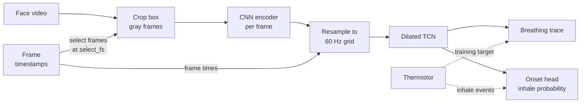

---
hide:
  - navigation
---

# Zephyr

Breathing from video. Zephyr is a CNN + TCN network that predicts a mouse's
breathing trace, and each inhale, from a face camera. It takes you from raw videos to a
trained, scored network and its predictions on new animals.

[Get started](installation.md){ .md-button .md-button--primary }
[Tutorial](tutorial/index.md){ .md-button }
[GitHub](https://github.com/AllenNeuralDynamics/zephyr){ .md-button }

## What zephyr does

You train it on recordings that have a breathing sensor (a nasal thermistor, for
example) beside the face camera. It then predicts breathing on videos that have no
sensor.

- **One input: gray frames.** Each frame is cropped to a box around the snout and
  converted to gray. Zephyr needs no markers and no pose tracking.
- **Two outputs.** It predicts a continuous breathing trace, plus an *onset head* that
  marks each inhale with a probability.
- **One desktop app.** The app walks a project from videos to predictions. Every step
  it takes is also a `zephyr` command you can script.
- **Honest scores.** Video and sensor are compared by time, never by sample index.
  Training clips can never be scored by mistake, and quality control (experimental)
  judges predictions on videos with no sensor.

-   :material-download:{ .lg .middle } **Install**

    ---

    Python 3.11+, `uv` and `ffmpeg`. CPU or CUDA.

    [:octicons-arrow-right-24: Installation](installation.md)

-   :material-school:{ .lg .middle } **Tutorial**

    ---

    From a folder of videos to a trained network and its predictions, in the app.

    [:octicons-arrow-right-24: Start the tutorial](tutorial/index.md)

-   :material-folder-cog:{ .lg .middle } **Your own data**

    ---

    Which files zephyr needs, how to name them, and how to split animals fairly.

    [:octicons-arrow-right-24: Preparing your data](guides/your-data.md)

-   :material-console:{ .lg .middle } **Command line**

    ---

    The same steps as commands, for clusters and scripts.

    [:octicons-arrow-right-24: The command line](guides/command-line.md)

## How it works

Frames are picked from the camera's own frames at `select_fs` (60 Hz by default), by
their timestamps. A **CNN** encodes each cropped gray frame into a vector. The vectors
are then resampled onto a fixed 60 Hz grid, again using the real frame timestamps, so
irregular frame intervals land at their true times. A **dilated temporal convolutional network**
(TCN) then reads the whole sequence. It is non-causal, because inference runs offline
on complete clips. Two heads read the TCN's output:

- the **signal head** predicts the z-scored breathing trace, trained with a
  correlation loss against the thermistor;
- the **onset head** predicts the probability of an inhale at each sample, trained
  against the inhale peaks a detector finds on the thermistor.

Inhales are read from the onset head, not from peaks on the trace.

## The workflow

| Step | In the app | Command |
| --- | --- | --- |
| List the videos and check their files | [Clips](tutorial/clips.md) | `zephyr clips scan`, `zephyr clips check` |
| Place one crop box per recording | [Boxes](tutorial/boxes.md) | `zephyr annotate --prepare`, `--auto` |
| Check the breathing events the network learns from | [Breathing](tutorial/breathing.md) | `zephyr annotate events --auto` |
| Crop every clip into a feature cache | [Train](tutorial/train.md) | `zephyr preprocess` |
| Split sessions, train and score | [Train](tutorial/train.md) | `zephyr run` |
| Read the scores and traces | [Results](tutorial/results.md) | `zephyr evaluate` |
| Predict and judge new videos | [Predict](tutorial/predict.md) | `zephyr predict`, `zephyr quality-control` |

## About

Zephyr is developed at the [Allen Institute for Neural
Dynamics](https://alleninstitute.org/division/neural-dynamics/) and released under the
MIT license. Report problems and ask questions on [GitHub
issues](https://github.com/AllenNeuralDynamics/zephyr/issues).
