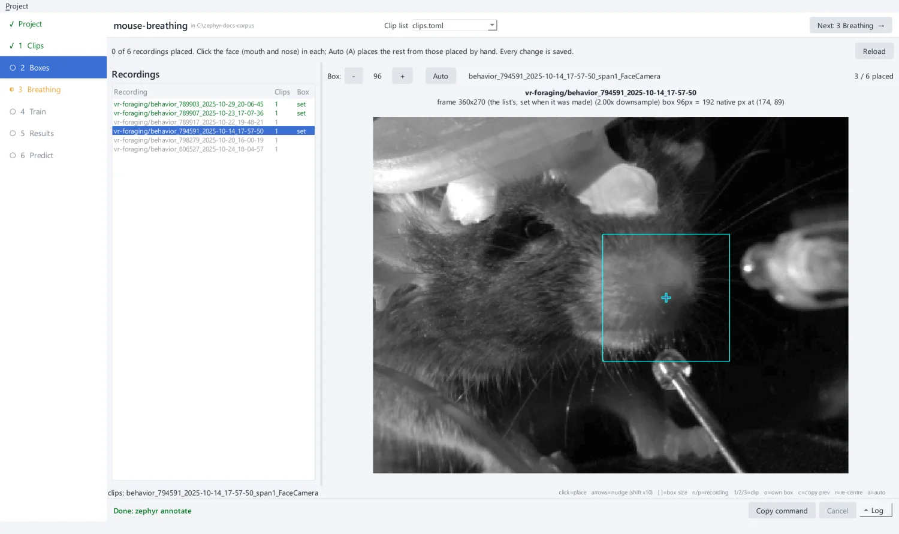
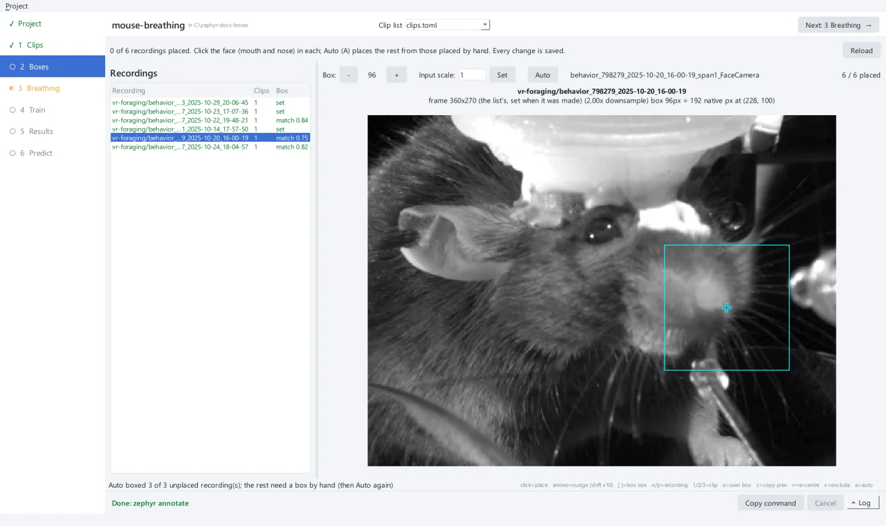

# 3. Place crop boxes

The network never sees the whole frame. It sees a square **crop box** around the
snout, in gray. You place one box per **recording**, a session's clips from one
folder: the camera does not move within a recording, so one box covers all its clips.
This is the only labelling zephyr needs from you by hand.

## Cache one frame per clip

Boxes are placed on one still frame of each clip: the frame at 150 s, or halfway
through a shorter clip. On **2 Boxes**, if the page says some clips have no cached
frame, click **Cache one frame per clip**. The app runs `zephyr annotate --prepare`,
which writes the frames into the project's `frames/`.

!!! tip "Videos on another machine"
    Once the frames are cached, placing boxes needs only `frames/`. You can place boxes
    on a laptop for a list whose videos live on a server.

## Place the boxes

The page lists the recordings on the left and shows the selected one's frame on the
right.

1. Set the box size with **−** and **+** (or ++bracket-left++ and ++bracket-right++).
   Every clip in a list must use **one size**. 96 pixels on a 360 × 270 frame is the
   reference setting.
2. **Click the face**, between the mouth and the nose. The box centres where you
   click. Nudge it with the arrow keys (++shift++ moves it 10 pixels at a time).
3. Press ++n++ for the next recording, ++p++ for the previous one, and place a few by
   hand.

{ .screen }

Placed recordings turn green and read **set**. Every change is saved to the clip list
straight away, as `box = [x, y, w, h]` in pixels of the list's frame size.

!!! note "Where to put the box"
    Centre the box on the nostrils and mouth, with some cheek and whisker pad around
    them. Those are what move with each breath. Keep the eye out of the box if you can:
    blinks and eye movements are not breathing.

## Let Auto place the rest

Click **Auto** (or press ++a++). Each box you placed by hand becomes a template. Auto
matches the templates against each unplaced recording's frame, using normalised
cross-correlation. A recording whose best match scores at least 0.5 gets a box there,
shown as **match 0.84** until you move it. The rest stay unplaced: place one of them by
hand, then run Auto again.

{ .screen }

**Check every matched box.** Click each "match" row and look at the box. Move it if it
is off. A moved box reads **set**.

## Keys

| Key | Does |
| --- | --- |
| click | place the box, centred where you click |
| ++arrow-left++ ++arrow-right++ ++arrow-up++ ++arrow-down++ | nudge the box by 1 pixel (++shift++: 10) |
| ++bracket-left++ / ++bracket-right++ | make the box smaller / larger |
| ++n++ / ++p++ | next / previous recording |
| ++1++ ++2++ ++3++ | show the recording's first, second or third clip |
| ++o++ | give this clip its own box, apart from its recording's |
| ++c++ | copy the previous recording's box |
| ++r++ | re-centre: remove this recording's box |
| ++a++ | Auto: place the unplaced recordings from the placed ones |

??? example "The same from the command line"

    ```bash
    uv run zephyr annotate mouse-breathing/clips.toml --prepare --frame-dir mouse-breathing/frames
    uv run zephyr gui mouse-breathing/clips.toml --page boxes   # place a few by hand
    uv run zephyr annotate mouse-breathing/clips.toml --auto --frame-dir mouse-breathing/frames
    ```

    Placing boxes by hand happens only in the app. `annotate --auto` takes
    `--min-score` (default 0.5).

[Next: check the breathing labels :octicons-arrow-right-24:](breathing.md){ .md-button .md-button--primary }
