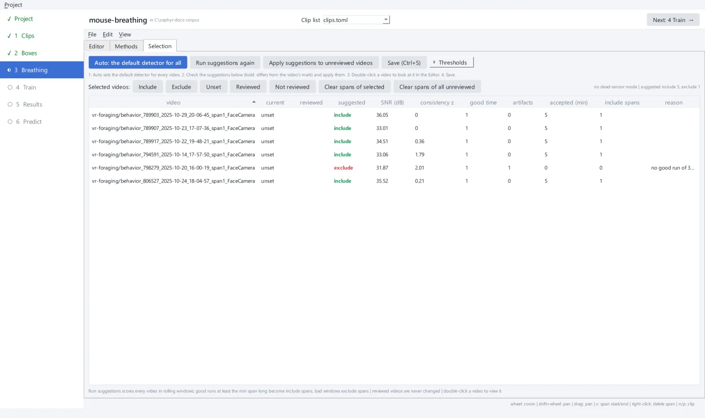
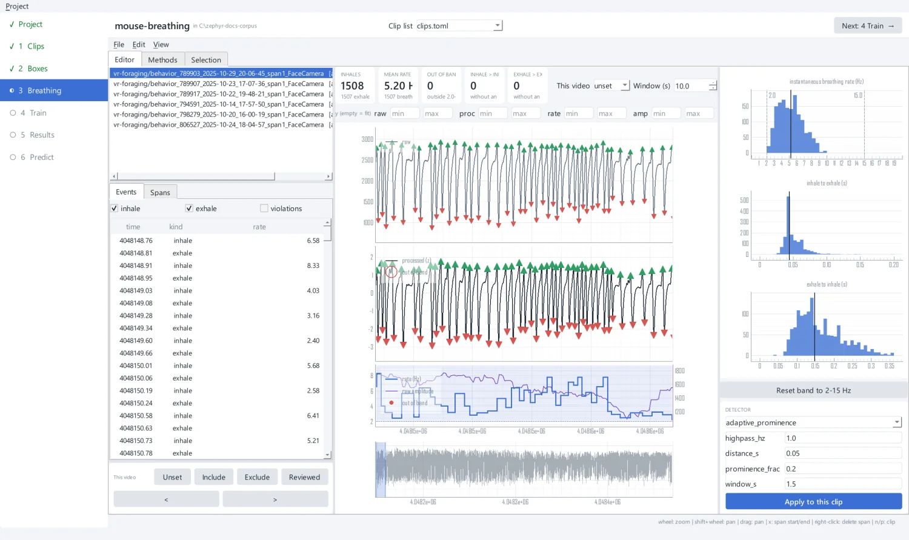
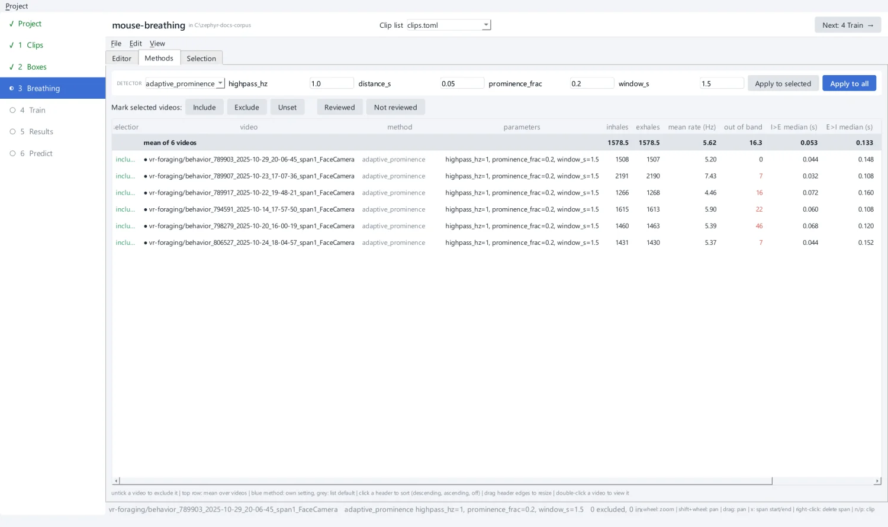

# 4. Check the breathing labels

The network learns from the breathing sensor. The **signal head** learns the sensor's
trace, and the **onset head** learns the inhale times a **detector** finds on it. This
step checks that those events are right, and leaves out data you cannot trust. You
never place events by hand: you choose the detector, and mark stretches or whole clips
to leave out.

!!! note "Inhale is up"
    Zephyr reads an inhale as a **peak** of the sensor and an exhale as a trough, as
    with a nasal thermistor, which cools when the animal breathes in. A sensor whose
    inhale is a trough must be negated before you write its file (see [Preparing your
    own data](../guides/your-data.md)).

## Start from the suggestions

**3 Breathing** opens on the **Selection** tab. The app has already scored every clip
in rolling windows: signal-to-noise ratio, how consistent its events are, out-of-band
breaths, inhale/exhale alternation breaks and artifacts. It then suggests a mark for
each clip, **include** or **exclude**, with a reason.

{ .screen }

1. Click **Auto: the default detector for all**. Every clip gets the default detector
   (`adaptive_prominence`), which becomes the list's `[events]`.
2. Read the suggestions. A bold suggestion differs from the clip's current mark.
3. **Apply suggestions to unreviewed videos** if you agree with them, or mark the
   clips yourself (below).
4. **Save** (++ctrl+s++).

!!! tip "Suggestions are a starting point"
    The suggestions look for long, clean runs (300 s by default, under **Thresholds**).
    On short clips one artifact can leave no such run, as for 798279 here: its
    5-minute clip has one artifact, so it is suggested for exclusion. Look at a clip in
    the **Editor** before you exclude it (double-click it to open it there). In this
    tutorial every clip is kept: mark them all **Include**.

## Look at a clip in the Editor

Double-click a clip, or open the **Editor** tab. It shows the clip's sensor, raw at the
top and filtered and z-scored below, with the inhales (green ▲) and exhales (red ▼) the
detector found. Below that are the breathing rate and amplitude, and an overview of the
whole clip.

{ .screen }

The cards at the top summarise the clip: the number of inhales, the mean rate, breaths
**out of band** (outside the 2-15 Hz band of mouse breathing), and how often two inhales
or two exhales come in a row. The histograms on the right show the instantaneous rate
and the inhale-to-exhale and exhale-to-inhale intervals.

!!! example "What to exclude"
    These six sessions passed the dataset's thermistor QC, so you should find nothing
    to leave out. On your own recordings, look for a mean rate far from the other
    sessions, many breaths out of band, or deep irregular dips that no detector setting
    turns into clean breaths. A network trained on such labels learns the sensor's
    faults, and one scored on them is judged against the wrong answer: exclude the
    clip, or the bad stretch.

To change the detector, choose it and its parameters under **Detector**, then **Apply
to this clip**. The events and metrics update at once.

| Detector | Finds | Use it when |
| --- | --- | --- |
| `peak_detection` | peaks above one prominence threshold for the whole clip | the sensor's amplitude is steady |
| `adaptive_prominence` | peaks standing a fraction of the *local* range above their surroundings | the amplitude drifts, or shallow breaths sit beside deep ones (the default after **Auto**) |
| `hysteresis_cycles` | one peak and one trough per crossing of a local band | inhales and exhales must alternate strictly |

Every detector takes `highpass_hz`, the corner of the high-pass that removes the
sensor's drift.

## Compare the clips in Methods

The **Methods** tab has one row per clip, with its detector, parameters and metrics,
and a mean row at the top. Here you can apply a detector to the selected clips or to
all of them, and mark them.

{ .screen }

## Mark clips and stretches

- **A whole clip.** Mark it **Include** or **Exclude** (++ctrl+e++ cycles the mark).
  An excluded clip is left out of everything downstream: preprocessing, training and
  scoring. **Reviewed** (++ctrl+r++) records that you checked it. The suggestions
  never change a reviewed clip.
- **A bad stretch.** In the Editor, press ++x++ at the start of the stretch, then ++x++
  at its end. Nothing is scored there and no training window overlaps it. ++i++ marks
  an *included* stretch, which is a note only. Drag a span's edges to move it, and
  delete it with a right-click or ++shift+x++. ++ctrl+z++ undoes.

Save with **File → Save** (++ctrl+s++). The detector, marks, spans and `reviewed` are
written next to each clip's box, keeping the file's comments and layout:

```toml
[[clip]]
video = "../vr-foraging/behavior_789903_2025-10-29_20-06-45_span1_FaceCamera.mp4"
box = [230, 98, 96, 96]
reviewed = true
selection = "include"
excluded = [[112.4, 118.0]]     # seconds on the sensor's clock
```

The step is marked done once every clip with a sensor is decided: reviewed, or marked
include or exclude.

??? example "The same from the command line"

    ```bash
    uv run zephyr annotate events mouse-breathing/clips.toml --auto   # the default detector
    uv run zephyr gui mouse-breathing/clips.toml --page breathing      # check by hand
    ```

[Next: train a network :octicons-arrow-right-24:](train.md){ .md-button .md-button--primary }
