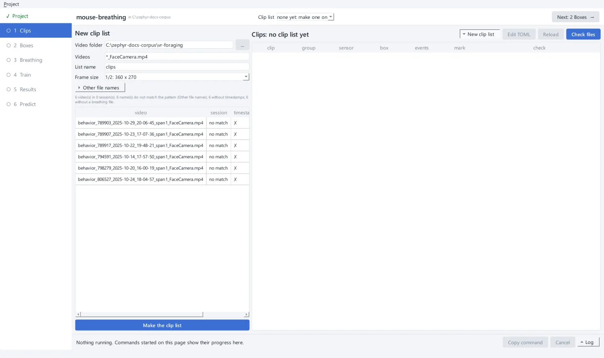
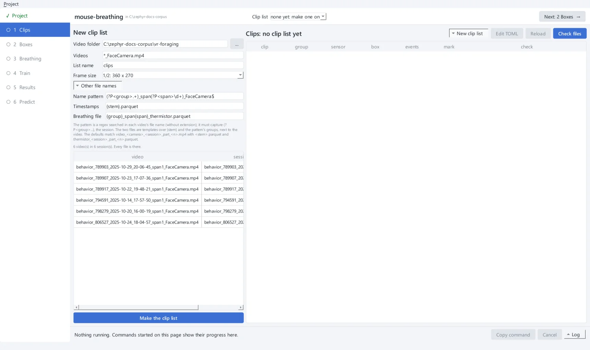
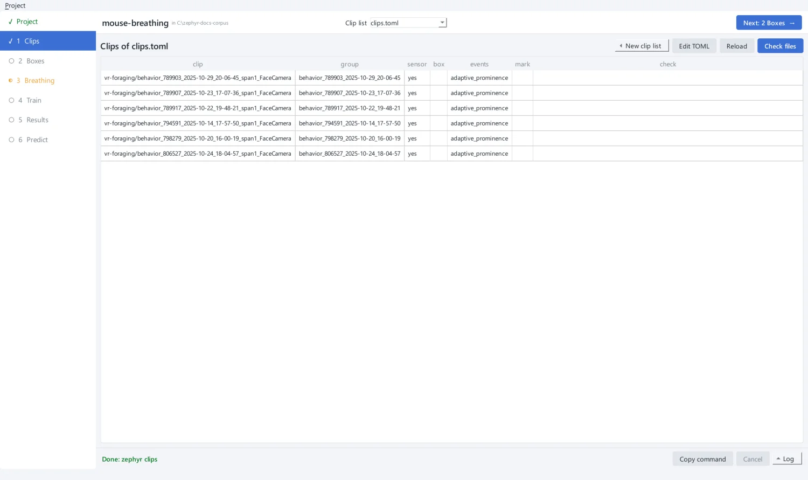
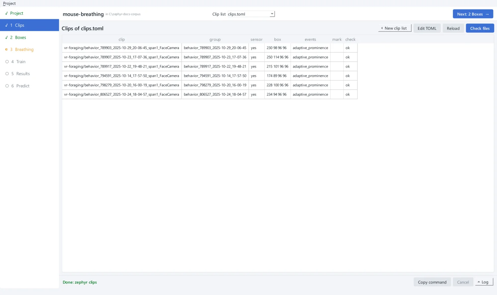

# 2. List the clips

A **clip list** is a TOML file that names your videos. Zephyr works out each clip's
timestamps, breathing file and session (its `group`) from the video's file name. The
list also holds what you add in the next steps: a crop box per clip and the breathing
labels.

## Scan the video folder

On **1 Clips**, fill in **New clip list**:

| Field | Value | Meaning |
| --- | --- | --- |
| Video folder | `vr-foraging` | where the videos are (any drive) |
| Videos | `*_FaceCamera.mp4` | which files to list (a glob pattern) |
| List name | `clips` | the list is saved as `clips.toml` in the project |
| Frame size | `1/2: 360 x 270` | the size each frame is shrunk to before cropping |

As you type, the app shows what the scan would list: each video's session, and whether
its timestamps (✓) and breathing file (✓) were found. Here every name reads **no
match**: these files are not named the way zephyr expects by default.

{ .screen }

!!! tip "Choosing the frame size"
    Boxes are placed on frames shrunk to this size, and every crop is taken from them.
    It is **fixed for the list**: a new size means a new list. 360 × 270 with 96-pixel
    boxes is the setting of zephyr's dataset. Keep it if you may want to start from a
    network trained on that dataset.

### Tell zephyr how the files are named

By default zephyr expects `video_<camera>_<session>_part_<n>.mp4`, with
`<stem>.parquet` for timestamps and `thermistor_<session>_part_<n>.parquet` for the
breathing sensor. For any other naming, open **Other file names**:

- **Name pattern** is a regular expression searched in each video's name, without the
  extension. It must capture `(?P<group>...)`, the session.
- **Timestamps** and **Breathing file** are templates for the file names, next to the
  video. They can use `{stem}` (the video's name without the extension) and any group
  the pattern captures.

The dataset names a clip `<session>_span<n>_FaceCamera.mp4`, its timestamps
`<stem>.parquet` (the default) and its thermistor `<session>_span<n>_thermistor.parquet`:

```text
Name pattern     (?P<group>.+)_span(?P<span>\d+)_FaceCamera$
Timestamps       {stem}.parquet
Breathing file   {group}_span{span}_thermistor.parquet
```

The preview updates as you type: every video now has its session, timestamps and
thermistor.

{ .screen }

See [Preparing your own data](../guides/your-data.md) for the rules the files must
follow.

## Make the list

Click **Make the clip list**. The app runs `zephyr clips scan` and opens the new list.
The table on the right shows each clip, its group, whether it has a sensor, and its box
and events once you add them.

{ .screen }

The list it wrote is short. The names you gave are its `[derive]` table, so each clip
needs only its video:

```toml title="mouse-breathing/clips.toml"
# Clip list written by `zephyr clips scan`.

[preprocess]
target_size = [360, 270]

[events]
method = "adaptive_prominence"
params = {highpass_hz = 1.0, distance_s = 0.05, prominence_frac = 0.2, window_s = 1.5}

[derive]
pattern = "(?P<group>.+)_span(?P<span>\\d+)_FaceCamera$"
thermistor = "{group}_span{span}_thermistor.parquet"

[[clip]]
video = "../vr-foraging/behavior_789903_2025-10-29_20-06-45_span1_FaceCamera.mp4"

[[clip]]
video = "../vr-foraging/behavior_789907_2025-10-23_17-07-36_span1_FaceCamera.mp4"
# ...
```

Paths are relative to the list. **Edit TOML** opens the list in your text editor to add
clips or set paths by hand. Save it there, then click **Reload**. If the list no longer
loads, the page says why.

## Check the files

**Check files** reads every file the list names and reports, per clip, anything that
preprocessing or training would refuse:

- missing files or columns;
- a video whose frame count differs from its timestamp rows;
- a camera slower than `select_fs`, or a sensor sampled at 80 Hz or less;
- a video and sensor that share no time;
- a missing crop box.

Run it again once the boxes are placed. Every clip should then read `ok`:

{ .screen }

??? example "The same from the command line"

    ```bash
    uv run zephyr clips scan vr-foraging --glob '*_FaceCamera.mp4' --target-size 360 270 \
        --pattern '(?P<group>.+)_span(?P<span>\d+)_FaceCamera$' \
        --thermistor '{group}_span{span}_thermistor.parquet' -o mouse-breathing/clips.toml
    uv run zephyr clips check mouse-breathing/clips.toml
    ```

[Next: place crop boxes :octicons-arrow-right-24:](boxes.md){ .md-button .md-button--primary }
