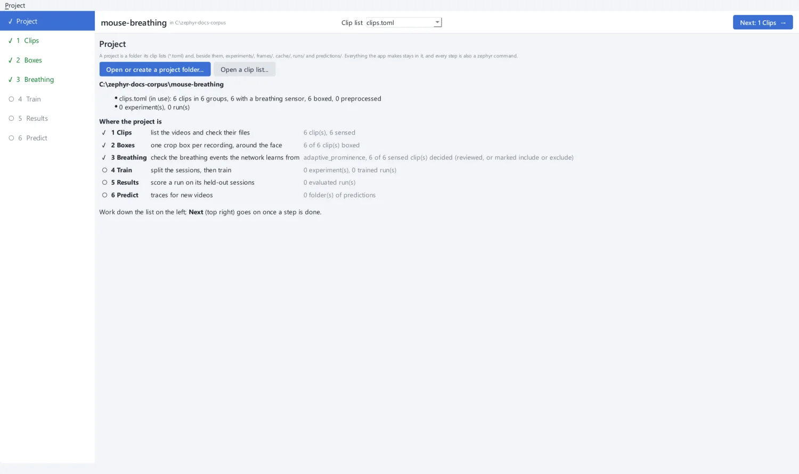

# Tutorial

This tutorial walks through a whole project in the app, from a folder of videos to a
network that predicts breathing on animals it has never seen. Each step also shows the
command the app runs, so you can do the same on a cluster.

You will:

1. [create a project](project.md), a folder that holds everything you make;
2. [list the clips](clips.md) and check that every file is there;
3. [place a crop box](boxes.md) around each recording's snout;
4. [check the breathing labels](breathing.md) the network learns from;
5. [train a network](train.md) on some sessions and hold out others;
6. [inspect the results](results.md) on the held-out sessions;
7. [predict breathing](predict.md) on new videos, which have no sensor, and judge
   the predictions.

{ .screen }

## Get the example data

The tutorial uses a few sessions of zephyr's own dataset: mice foraging in virtual
reality, filmed by a face camera (720 × 540 at 240 Hz) with a nasal thermistor. The
dataset is built by the repository's `zephyr-dataset` package and split by animal. The
tutorial takes one session of each of seven animals, and only its first 5-minute clip
(about 4 GB in all):

| Animal | Session | Used for |
| --- | --- | --- |
| 789903, 789907, 794591, 798279 | one each | training |
| 789917 | one | stopping training early (validation) |
| 806527 | one | testing, as a new animal |
| 808728 | one | prediction: its video only, no sensor |

These are animals from the dataset's own training, validation and test splits, so the
tutorial holds out animals the same way.

```bash
R=s3://aind-scratch-data/vr-foraging/zephyr-dataset/clips

for s in behavior_789903_2025-10-29_20-06-45 behavior_789907_2025-10-23_17-07-36          behavior_794591_2025-10-14_17-57-50 behavior_798279_2025-10-20_16-00-19          behavior_789917_2025-10-22_19-48-21 behavior_806527_2025-10-24_18-04-57; do
  aws s3 cp --no-sign-request "$R/${s}_span1_FaceCamera.mp4" vr-foraging/
  aws s3 cp --no-sign-request "$R/${s}_span1_FaceCamera.parquet" vr-foraging/
  aws s3 cp --no-sign-request "$R/${s}_span1_thermistor.parquet" vr-foraging/
done

s=behavior_808728_2025-10-24_20-45-03
aws s3 cp --no-sign-request "$R/${s}_span1_FaceCamera.mp4" new-animal/
aws s3 cp --no-sign-request "$R/${s}_span1_FaceCamera.parquet" new-animal/
```

You get, for each session:

```text
vr-foraging/
  behavior_789903_2025-10-29_20-06-45_span1_FaceCamera.mp4       # the face camera
  behavior_789903_2025-10-29_20-06-45_span1_FaceCamera.parquet   # its frame timestamps
  behavior_789903_2025-10-29_20-06-45_span1_thermistor.parquet   # the nasal thermistor
  ...
new-animal/
  behavior_808728_2025-10-24_20-45-03_span1_FaceCamera.mp4       # video and timestamps only
  behavior_808728_2025-10-24_20-45-03_span1_FaceCamera.parquet
```

A session is named `behavior_<animal>_<date>_<time>`. Its clips add `_span<n>` and the
camera or sensor.

!!! tip "Using your own recordings"
    You can follow the tutorial with your own data. Read [Preparing your own
    data](../guides/your-data.md) first: it explains which files zephyr needs and how to
    name them.

## Open the app

```bash
uv run zephyr gui
```

The steps are listed on the left. Each is marked **✓** done, **◐** partly done or
**○** to do, from what the project folder holds. Above the page are the project, the
clip list every step works on, and **Next**, which lights up once a step is done.
Below the page, a panel shows the command the page is running. **Log** shows its
output, and **Copy command** copies the same command for a terminal.

[Start: create a project :octicons-arrow-right-24:](project.md){ .md-button .md-button--primary }
