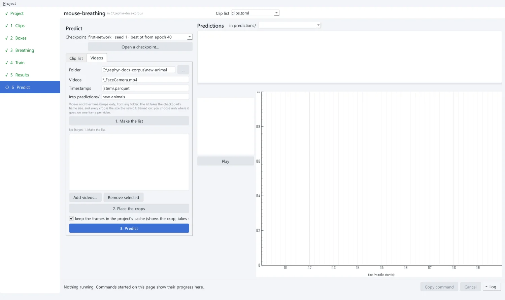
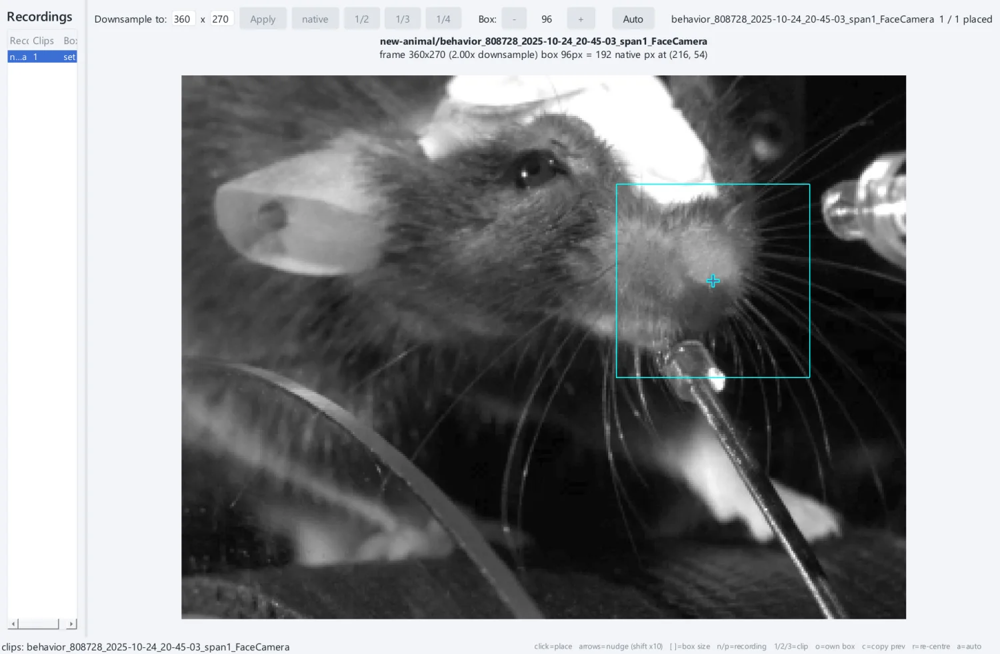
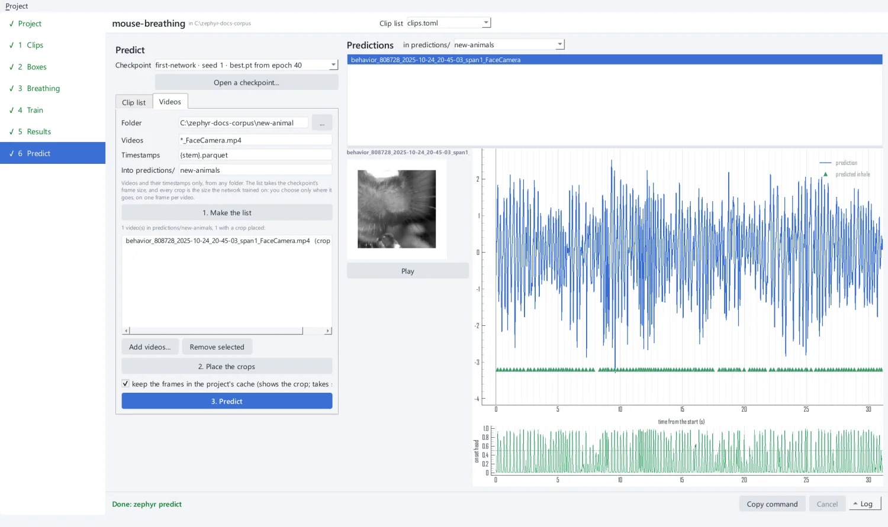
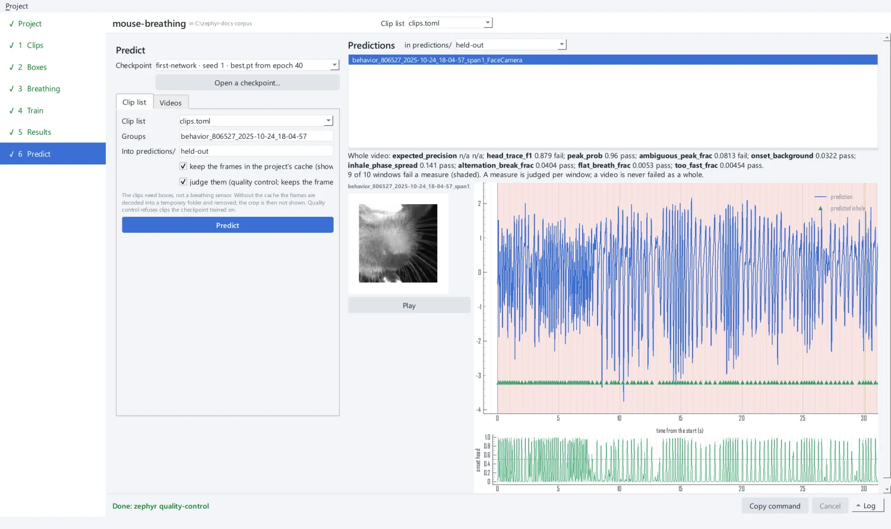

# 7. Predict new videos

**6 Predict** runs a trained network on videos that have no breathing sensor. Choose
the **Checkpoint** first: the app lists every run's `best.pt`, with the epoch it was
kept from. **Open a checkpoint...** takes one from anywhere.

There are two ways to give it videos:

- **Videos**: a folder of videos and timestamps from anywhere, such as new animals;
- **Clip list**: a list of the project, boxed as for training.

## Videos from a folder

On the **Videos** tab:

| Field | Value |
| --- | --- |
| Folder | `new-animal` |
| Videos | `*_FaceCamera.mp4` |
| Timestamps | `{stem}.parquet` |
| Into predictions/ | `new-animals` |

{ .screen }

### 1. Make the list

**1. Make the list** scans the folder into `predictions/new-animals/videos.toml`, a
list made for the checkpoint: its frame size and recipe, no sensor, and each video its
own group. It then caches one frame per video and opens the crop window.

### 2. Place the crops

The crop window works like the [Boxes page](boxes.md), with one difference: the box
size is the network's and cannot change. You choose only **where** it goes. Click the
snout of each video. With several videos, place one, then **Auto** (++a++) matches it
on the others; check each.

{ .screen }

**Add videos...** and **Remove selected** change the list later. A video added to the
list gets its frame cached, ready for its crop.

### 3. Predict

Tick **keep the frames in the project's cache** to see the crop beside the trace (it
takes space; the app says how much first). Then click **3. Predict**. The app runs
`zephyr predict` and lists the predictions on the right. Select a video to see its
trace, the inhales the onset head found (dots), the onset probability below it, and
the crop.

{ .screen }

Each video gets `predictions/new-animals/<video stem>.prediction.parquet`:

| Column | Holds |
| --- | --- |
| `time` | seconds, on the video's clock (60 Hz grid) |
| `frame` | the video frame at that time, counted from 0 |
| `signal` | the z-scored breathing trace, inhale up |
| `onset` | the onset head's inhale probability |
| `inhale` | true where the onset head found an inhale |

```python
import pandas as pd

p = pd.read_parquet(
    "predictions/new-animals/"
    "behavior_808728_2025-10-24_20-45-03_span1_FaceCamera.prediction.parquet"
)
inhale_times = p.loc[p["inhale"], "time"]
print(f"{len(inhale_times)} inhales, {1 / inhale_times.diff().median():.1f} Hz")
```

Predicting again into a folder that has predictions asks whether to predict every video
again (after moving a crop, or with another checkpoint) or only the new ones.

## Judge the predictions

!!! warning "Experimental"
    Quality control (**judge them**) is under active development. Its measures, their
    pass bounds and the report format may change, and they are not yet validated on
    enough held-out animals to be relied on. Use its checks as a hint about where to look, not as a
    verdict on a prediction.

With no sensor, nothing can be scored, but **quality control** judges each prediction
from the network's own output. On the **Clip list** tab, choose `clips.toml`, set
**Groups** to `behavior_806527_2025-10-24_18-04-57` (the test animal's session) and **Into predictions/** to `held-out`,
and tick **judge them (quality control)**. The app then runs `zephyr quality-control
run` after predicting. Quality control refuses clips the checkpoint trained on.

{ .screen }

Above the trace, each measure is shown for the whole video with pass or fail, and
windows that fail a measure are shaded. Here the onset head's inhales agree less with
the peaks of its own trace (`head_trace_f1`), and more of its peaks are ambiguous
(`ambiguous_peak_frac`), than the default bounds allow, while the rhythm measures pass.
That is what a network trained on four short clips for 40 epochs looks like: its
inhales are mostly right (head inhale F1 0.89 on this animal) but less certain. `expected_precision` reads n/a because no
reference was made for this checkpoint. A video is never failed as a whole: you decide
which measures matter. See [Quality control](../guides/quality-control.md) for what each
measure means and how its bound was chosen.

??? example "The same from the command line"

    ```bash
    uv run zephyr clips scan new-animal --glob '*_FaceCamera.mp4' \
        -o mouse-breathing/predictions/new-animals/videos.toml --checkpoint best.pt
    uv run zephyr annotate mouse-breathing/predictions/new-animals/videos.toml --prepare \
        --frame-dir mouse-breathing/frames
    uv run zephyr gui mouse-breathing/predictions/new-animals/videos.toml --page boxes
    uv run zephyr predict --checkpoint best.pt \
        --clips mouse-breathing/predictions/new-animals/videos.toml \
        --out mouse-breathing/predictions/new-animals --cache mouse-breathing/cache
    uv run zephyr quality-control run --checkpoint best.pt --clips mouse-breathing/clips.toml \
        --groups behavior_806527_2025-10-24_18-04-57 --cache mouse-breathing/cache --out mouse-breathing/predictions/held-out
    ```

## What next

- Train on your own recordings: [Preparing your own data](../guides/your-data.md).
- Hold out animals properly: [Designing experiments](../guides/experiments.md).
- Move the heavy steps to a GPU machine: [Working across
  machines](../guides/machines.md).
