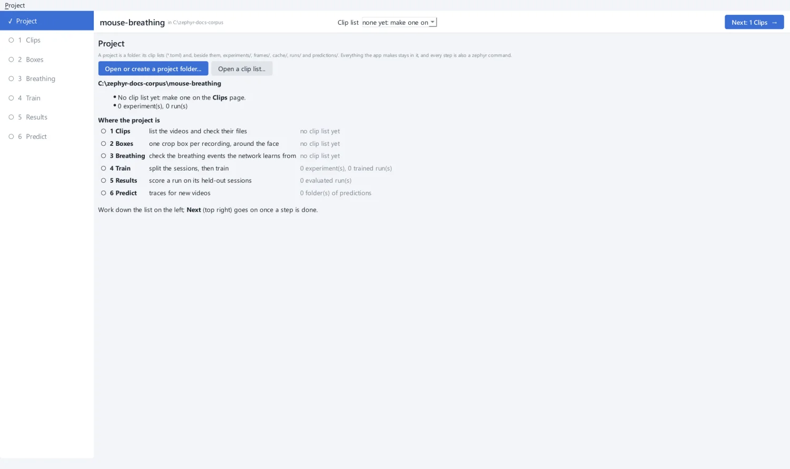

# 1. Create a project

A **project** is a folder. Its clip lists (`*.toml`) sit at the top, and beside them
are folders for everything made from them:

```text
mouse-breathing/
  clips.toml        # a clip list: the videos, their crop boxes and breathing labels
  experiments/      # each experiment, written once and never edited
  frames/           # one frame per clip, to place boxes on
  cache/            # the feature cache: every clip's cropped gray frames
  runs/             # trained networks, their scores and traces
  predictions/      # traces predicted for new videos
```

Your videos stay where they are. A clip list names them by path, so the project folder
and the data folder can be on different drives.

## Make the project

1. Start the app with `uv run zephyr gui`.
2. On **Project**, click **Open or create a project folder...**.
3. Choose an empty folder, here `mouse-breathing`.
4. The app asks before it makes the folder a project. Answer **Yes**.

{ .screen }

The page shows where each step stands, and the same marks appear in the list on the
left. Nothing is done yet, so everything but Project is **○**.

!!! tip "Open it again later"
    **Project → Recent projects** lists the projects you opened before. From a
    terminal, `uv run zephyr gui mouse-breathing/` opens a project directly, and
    `uv run zephyr gui mouse-breathing/clips.toml --page boxes` opens it on a page.

!!! note "What the app writes"
    The app only ever writes clip lists and new experiments into your project, and the
    outputs of the commands it runs. It never edits an experiment once written, and
    never changes a folder that is not a project without asking.

[Next: list the clips :octicons-arrow-right-24:](clips.md){ .md-button .md-button--primary }
