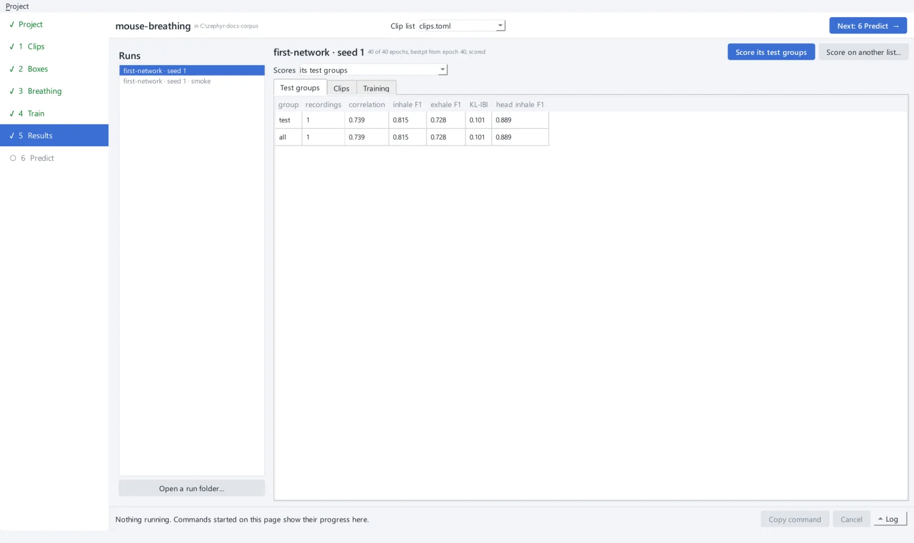
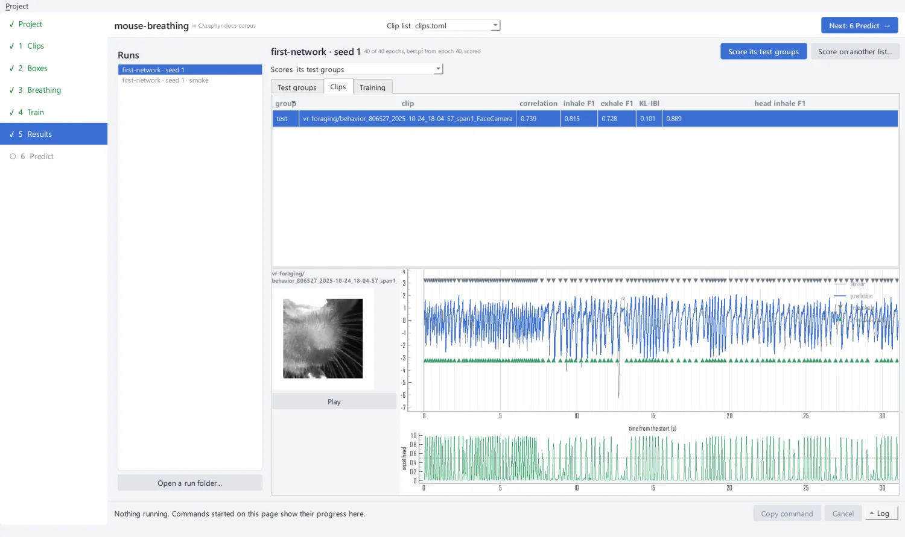
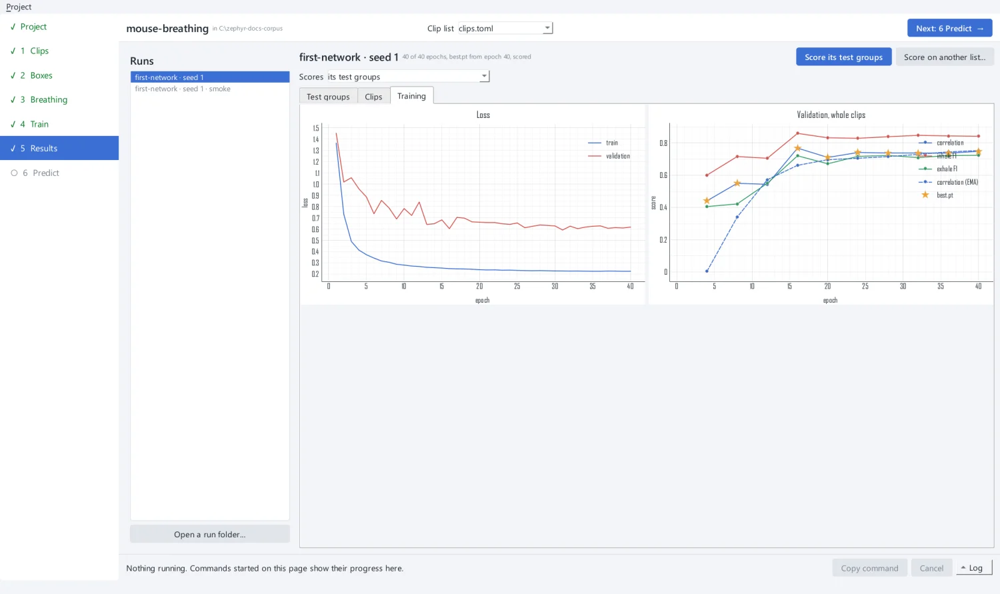

# 6. Inspect the results

**5 Results** lists the project's runs on the left: real runs first, newest first, and
smoke runs greyed out after them. Pick a run to see its scores.

## Test groups

**Test groups** shows the scores of each test group of the run's experiment, averaged
over its recordings, from the run's `evaluation.json`.

{ .screen }

| Column | Meaning | Better |
| --- | --- | --- |
| correlation | correlation of the predicted and true traces | higher, up to 1 |
| inhale F1 | inhales found as peaks on the predicted trace | higher, up to 1 |
| exhale F1 | exhales found as troughs on the predicted trace | higher, up to 1 |
| KL-IBI | how far the rhythm (inter-inhale intervals) is from the truth | lower, down to 0 |
| head inhale F1 | inhales asserted by the onset head: **the** inhale score of this network | higher, up to 1 |

An event matches a true one within 1.5 output frames (25 ms at 60 Hz). See
[Scoring](../reference/scoring.md) for every rule.

This tutorial's network, trained on one 5-minute clip of each of four animals for 40
epochs, scores a correlation of 0.74 and a head inhale F1 of 0.89 on 806527, an animal
it never saw. More sessions and animals, and the full 200 epochs, give a network that
holds up better on new animals.

## Clips

**Clips** has one row per test clip. Select one to draw its predicted trace (with the
inhales the onset head found and the onset probability below) against the true sensor.
When the clip's frames are in the cache, the crop the network saw plays along with the
trace.

{ .screen }

Runs started from the app save the traces they score (`--save-traces`, about 1 MB per
test clip), so drawing them does not run the network again.

## Training

**Training** shows the run's curves, read from its `history.json`, the same as the
Train page.

{ .screen }

## Score again, or on other clips

- **Score its test groups** scores the run's `best.pt`, finished or stopped, on its
  experiment's test groups (`zephyr run --evaluate-only`). It asks before replacing an
  `evaluation.json`.
- **Score on another list...** scores `best.pt` on another clip list of the project
  (`zephyr evaluate`), into the run's `scores/`. Clips the run trained on are refused.
- **Open a run folder...** shows a run from elsewhere, read only.

!!! tip "One session is not a benchmark"
    This tutorial tests on a single held-out session to stay short. For results you
    report, hold out several animals, rotate them across folds, and pool the scores.
    See [Designing experiments](../guides/experiments.md).

??? example "The same from the command line"

    ```bash
    uv run zephyr run mouse-breathing/experiments/first-network.toml --evaluate-only
    uv run zephyr evaluate --checkpoint mouse-breathing/runs/first-network/first-network/seed-1/best.pt \
        --clips other-animals.toml --cache mouse-breathing/cache --out other-animals.json
    ```

[Next: predict new videos :octicons-arrow-right-24:](predict.md){ .md-button .md-button--primary }
