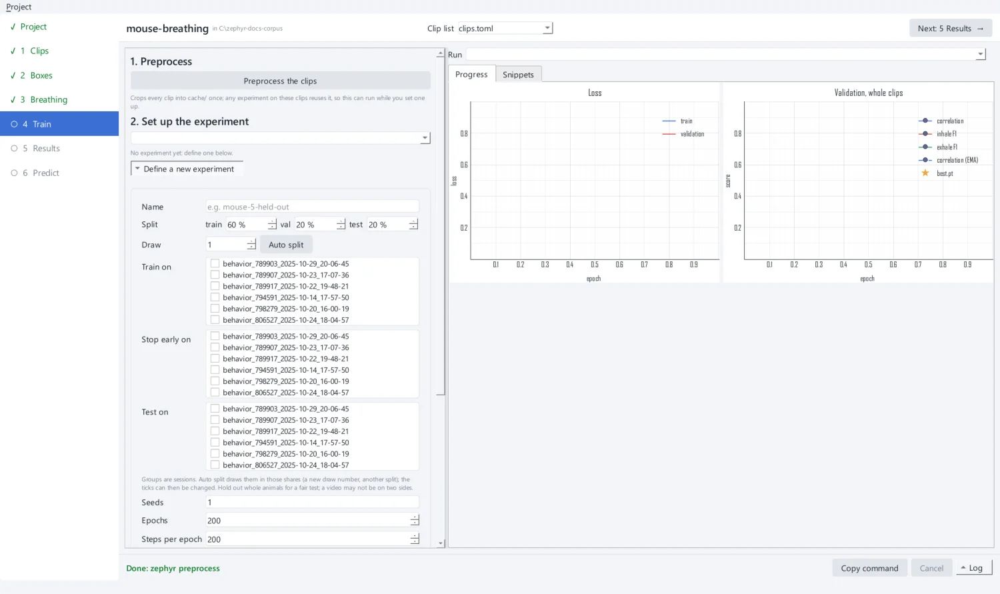
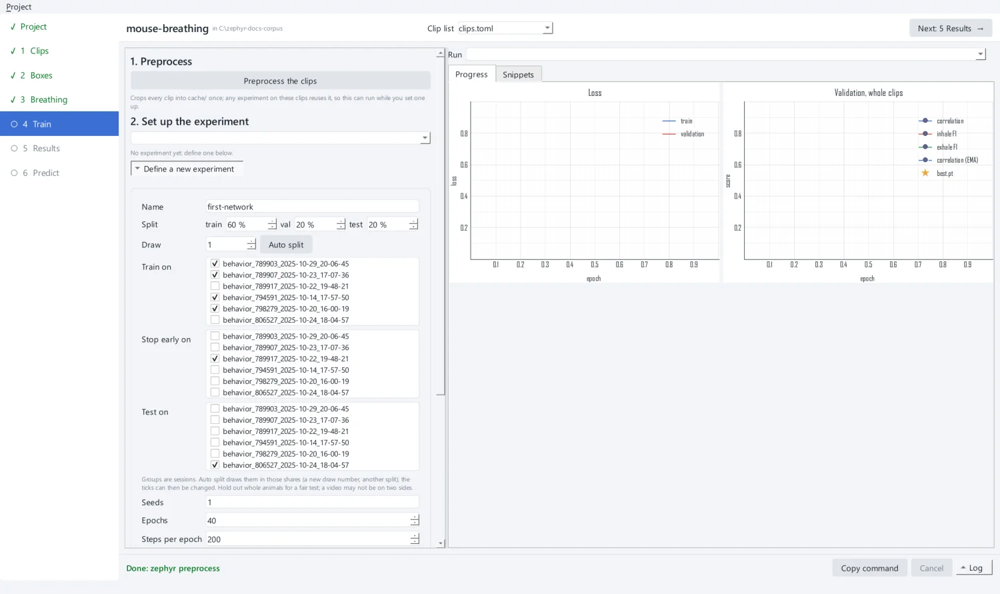
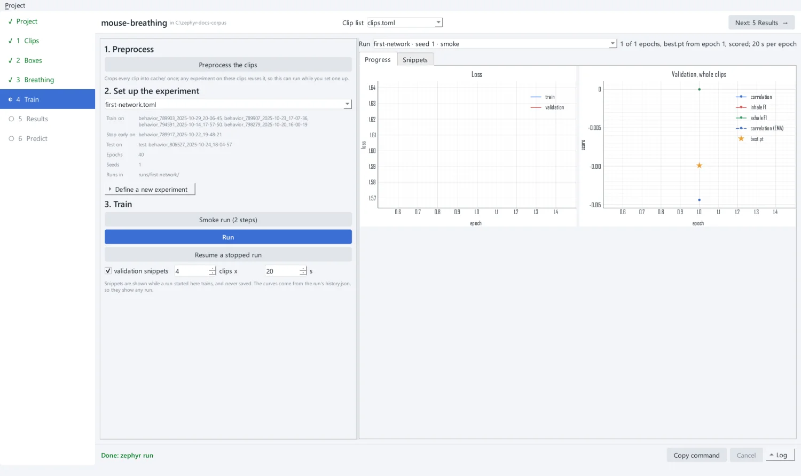
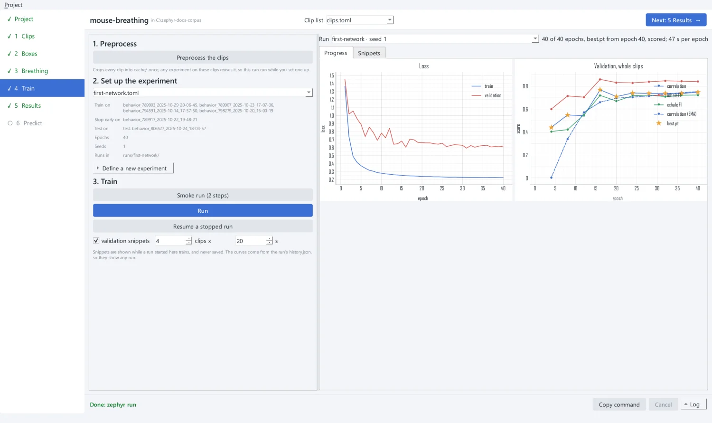
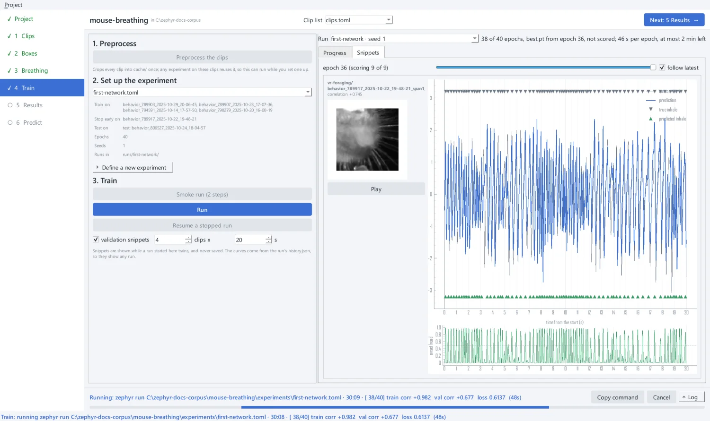

# 5. Train a network

**4 Train** has three parts, done in order: preprocess the clips, set up an
experiment, and train.

## Preprocess the clips

Training does not decode video. It reads a **feature cache**: every clip's cropped gray
frames, decoded once, at `select_fs` (60 Hz by default). Click **Preprocess the clips**.
The app first says how much space the cache will take and how much the drive has, then
runs `zephyr preprocess` into the project's `cache/`.

{ .screen }

Cache entries are keyed by video, recipe and box. Re-running does only what changed,
and a moved box or a changed detector rebuilds only those clips. Any experiment on these
clips reuses the cache, so preprocessing can run while you set up an experiment.

## Set up an experiment

An **experiment** says what trains, what stops training early, and what is scored. Open
**Define a new experiment**:

| Field | Here | Meaning |
| --- | --- | --- |
| Name | `first-network` | the experiment's file, `experiments/first-network.toml`, and its run folder |
| Split / Draw | 60 / 20 / 20 % | **Auto split** ticks sessions in these shares (another draw number, another split); change the ticks as you like |
| Train on | the sessions of 789903, 789907, 794591 and 798279 | the sessions the network learns from |
| Stop early on | the session of 789917 | validation sessions: scored during training to keep the best weights and stop when they stop improving |
| Test on | the session of 806527 | held-out sessions, scored once training ends |
| Seeds | 1 | one run per seed |
| Epochs | 40 | at most this many epochs of 200 steps (default 200; 40 keeps the tutorial under 40 minutes) |

{ .screen }

Device, precision and data workers default to the machine's best: CUDA if present,
bf16, and 4 data workers.

!!! warning "Hold out whole animals"
    Groups are **sessions**, named `behavior_<animal>_<date>_<time>`. Here each animal
    has one session. With several, all of an animal's sessions must be on the same
    side: a network scored on new sessions of an animal it trained on looks better than
    it will on a new animal. A video can never be on two sides, and the experiment is
    refused if one is.

Click **Write experiment**. The app validates the experiment before keeping it, and
never overwrites one: to change an experiment, write a new one.

```toml title="experiments/first-network.toml"
# Experiment first-network, written by the zephyr app.
seeds = [1]
output_dir = "../runs/first-network"
features_dir = "../cache"

[[fold]]
name = "first-network"

[[fold.train]]
clips = "../clips.toml"
groups = [
    "behavior_789903_2025-10-29_20-06-45",
    "behavior_789907_2025-10-23_17-07-36",
    "behavior_794591_2025-10-14_17-57-50",
    "behavior_798279_2025-10-20_16-00-19",
]

[fold.val]
clips = "../clips.toml"
groups = ["behavior_789917_2025-10-22_19-48-21"]

[fold.test]
test = {clips = "../clips.toml", groups = ["behavior_806527_2025-10-24_18-04-57"]}

[fold.train_params]
epochs = 40
```

## Smoke-run first

Click **Smoke run (2 steps)**. It runs one epoch of two steps, then scores the test
sessions. It catches a bad config, a missing cache entry or a GPU problem in about a
minute, before you commit hours to a run. Its scores mean nothing.

{ .screen }

## Run

Click **Run**. The network trains into `runs/first-network/first-network/seed-1/`.

**Progress** draws the training and validation loss, and the validation scores
(correlation, inhale and exhale F1) every `score_every` epochs. A star marks the epoch
`best.pt` was kept from.

{ .screen }

**Snippets** shows, after each validation scoring, a few seconds of a few validation
clips: the true and predicted traces with their inhales, and the crop the network saw,
played along. Snippets are shown, never saved, and they never change training.

{ .screen }

Training stops early once validation has not improved for `patience` scorings (after at
least `min_epochs` epochs), or after the last epoch. Then the run scores its test
sessions with `best.pt` and writes `evaluation.json`.

!!! tip "Stopping and resuming"
    **Cancel** stops a run. **Resume a stopped run** continues it from `last.pt`.
    **Run** on an experiment that already has a run asks before starting it over. The
    app runs every command in a child process, so closing a window or a crash never
    loses the app.

??? example "The same from the command line"

    ```bash
    uv run zephyr preprocess mouse-breathing/clips.toml --cache mouse-breathing/cache
    uv run zephyr run mouse-breathing/experiments/first-network.toml --smoke
    uv run zephyr run mouse-breathing/experiments/first-network.toml --save-traces
    ```

    See [Designing experiments](../guides/experiments.md) for folds, cross-validation
    and starting from a trained network.

[Next: inspect the results :octicons-arrow-right-24:](results.md){ .md-button .md-button--primary }
